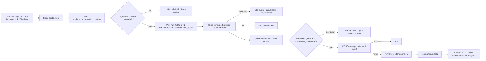
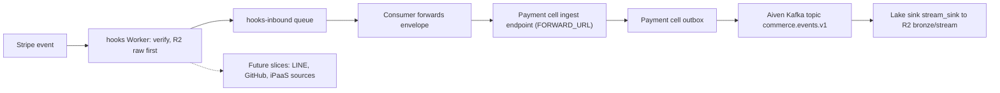

# 01 — Business process (As-Is / To-Be)

repo นี้คือ Cloudflare Worker `solo-empire-hooks` บน `hooks.bookchaowalit.com` ทำหน้าที่รับ signed inbound webhook จาก Stripe (slice เดียวตอนนี้) แล้วเขียน raw event ลง R2 ก่อนทำอย่างอื่น จากนั้นส่ง envelope เข้า Cloudflare Queue `hooks-inbound` ตาม ADR-0008 M1 ไม่มี end user — caller มีแค่ Stripe และ uptime Worker

## As-Is (จาก code วันนี้)

Sources: `src/worker.ts`, `wrangler.toml`, `README.md`, `PRODUCT.md`

สถานะจริง (README "Queue (2026-11-03)"): ยังไม่ได้ตั้ง `FORWARD_URL` ดังนั้น consumer จะ ack ทุก message; ขั้นตอนที่ตามมา (reconcile กับ Stripe Dashboard ใน PRODUCT.md "Success measures") ทำด้วยมือ

## To-Be (จาก docs ของ repo และ ADR-0008 เท่านั้น)

Sources: `README.md` (Queue section: "the payment cell's ingest endpoint becomes the target when it is ready"; "LINE, GitHub, and iPaaS sources are future slices"), `PRODUCT.md` ("Out of scope today"), [ADR-0008](https://github.com/bookchaowalit/architecture-docs/blob/main/docs/architecture/decisions/ADR-0008-messaging-queue-and-event-broker.md) (rollout M3/M4)

## Open questions
- payment cell ingest endpoint จะเป็น URL ไหน และใครเป็นเจ้าของ `FORWARD_TOKEN`? (README บอกแค่ "when it is ready")
- ลำดับ/กำหนดเวลาของ slice LINE, GitHub, iPaaS ยังไม่มีใน repo
- การ reconcile R2 กับ Stripe Dashboard (PRODUCT.md) ยังไม่มี job อัตโนมัติ — จะทำหรือไม่?
