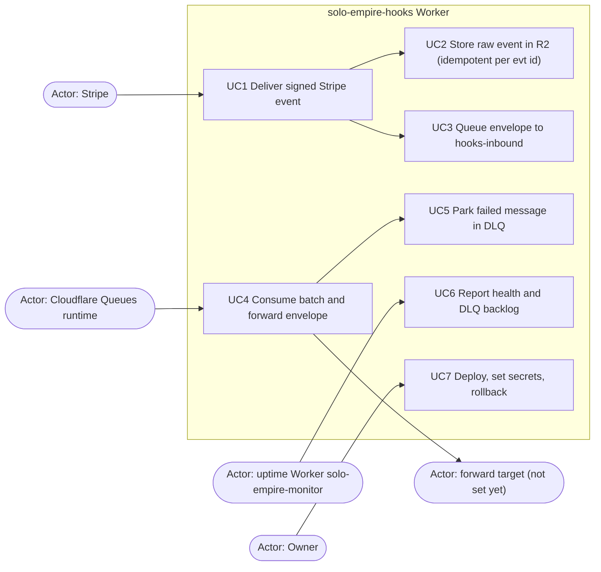

# 02 — Use cases

Actors คือ caller จริงที่ code รองรับ: Stripe (signed by `STRIPE_WEBHOOK_SECRET`), uptime Worker (`GET /healthz`, ไม่มี auth), Cloudflare Queues runtime (เรียก `queue()` handler), forward target (รับ bearer `FORWARD_TOKEN`) และ owner (deploy / secret ผ่าน wrangler) ไม่มี user login หรือ role อื่น

Sources: `src/worker.ts` (`handleRequest`, `handleStripe`, `handleQueue`, `handleHealth`), `wrangler.toml`, `README.md` ("Owner deploy steps", "Rollback"), `bookchaowalit/platform-uptime-worker:src/targets.ts` (target `hooks-worker`)

| Use case | Actor | Trigger | Result |
|---|---|---|---|
| UC1 | Stripe | `POST /stripe` + `Stripe-Signature` | `200 {"received":true}` หรือ `400/413/503` |
| UC2 | (ภายใน UC1) | signature ok, `evt_` id | object `bronze/stripe/YYYY/MM/DD/<id>.json` |
| UC3 | (ภายใน UC1) | หลัง R2 write | envelope ใน `hooks-inbound`; ส่งไม่ได้ → `503` |
| UC4 | Cloudflare Queues | batch ≤10, timeout 5 s | ack / retry |
| UC5 | Cloudflare Queues | retry ครบ 5 ครั้ง | message ใน `hooks-inbound-dlq` |
| UC6 | uptime Worker | cron ทุก 5 นาที | `200 ok` หรือ `503` เมื่อ DLQ backlog > 0 |
| UC7 | Owner | manual | `wrangler deploy` / `secret put` / `rollback` |

## Open questions
- ยังไม่มี actor ที่อ่าน DLQ แล้ว replay (ADR-0008: "DLQs have no consumer that acts") — กระบวนการ replay เป็นมือ?
