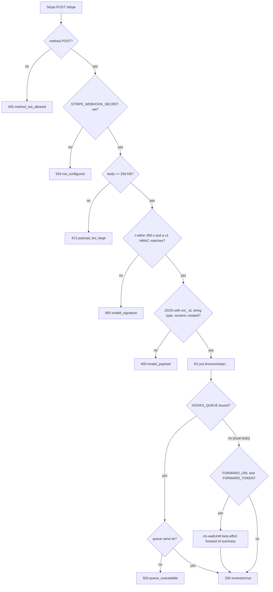
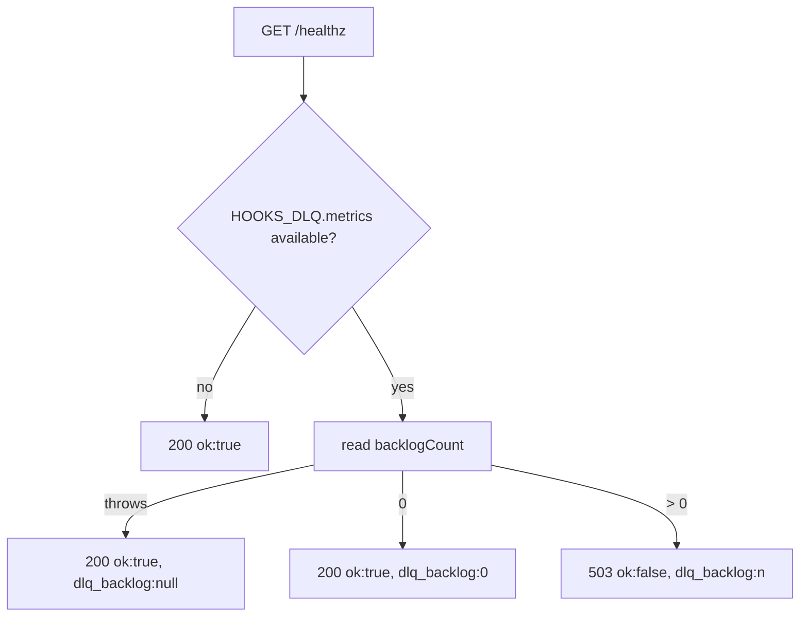
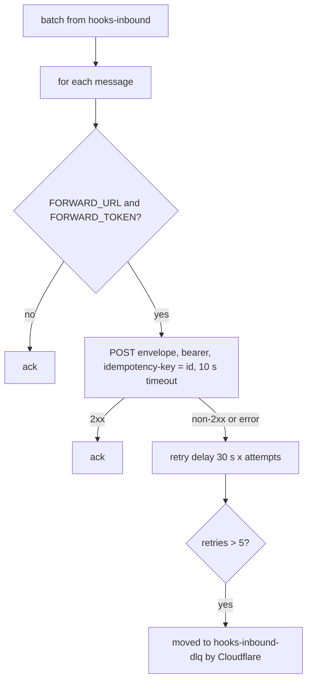

# 03 — User flows (per caller)

ไม่มีหน้าเว็บหรือ UI; "user" คือ caller ของ HTTP route และ queue ตาม `handleRequest` / `handleQueue`

## Flow A — Stripe ส่ง event (`POST /stripe`)

## Flow B — uptime Worker (`GET /healthz`)

## Flow C — Queue consumer

อื่น ๆ: path ใดที่ไม่ใช่ `/healthz` (GET) หรือ `/stripe` → `404 not_found` (รวม `POST /healthz`)

Sources: `src/worker.ts`, `wrangler.toml` (`[[queues.consumers]]`), `tests/worker.test.ts`, `tests/queue.test.ts`
