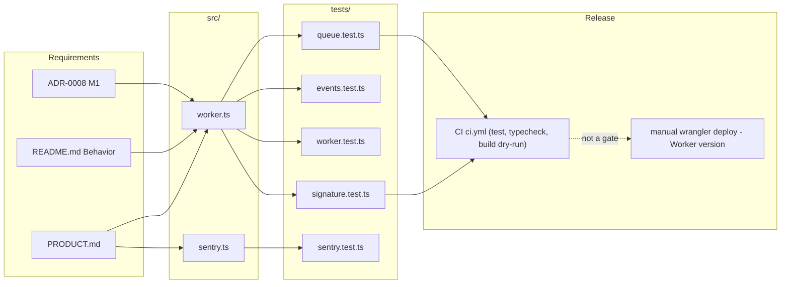

# 04 — Traceability (RTM)

repo ไม่มี `specs/` — requirement มาจาก `PRODUCT.md` ("What exists"), `README.md` ("Behavior") และ ADR-0008 (M1) Release คือ Worker version ที่ `wrangler deployments list` แสดง (deploy ด้วยมือ, CI ไม่ deploy)

| ID | Requirement | Source | Code | Tests | Release (Worker version) |
|---|---|---|---|---|---|
| R1 | `POST /stripe` ตรวจ `Stripe-Signature` HMAC-SHA256, constant-time, ±300 s | PRODUCT.md, README.md | `src/worker.ts` `verifyStripeSignature`, `timingSafeEqual`, `parseSignatureHeader` | `tests/signature.test.ts`, `tests/worker.test.ts` (bad / missing / stale / tampered) | `384e13fc` (2026-10-23) onward |
| R2 | หลาย `v1` signature ระหว่าง secret rotation | PRODUCT.md | `parseSignatureHeader` | `tests/signature.test.ts` "during secret rotation…" | `384e13fc` onward |
| R3 | body > 256 KB → 413 | PRODUCT.md, README.md | `readLimitedBody`, `MAX_BODY_BYTES` | `tests/worker.test.ts` "oversized body returns 413" | `384e13fc` onward |
| R4 | JSON ไม่ถูก / id ไม่ใช่ `evt_` → 400 ไม่เขียน R2 | PRODUCT.md | `handleStripe` | `tests/events.test.ts` | `384e13fc` onward |
| R5 | Raw event ลง R2 `bronze/stripe/YYYY/MM/DD/<id>.json`, idempotent | PRODUCT.md, README.md | `stripeObjectKey`, `HOOKS_BUCKET.put` | `tests/worker.test.ts` "valid signature stores…", "R2 key format…" | `384e13fc` onward |
| R6 | ไม่มี secret → 503 | README.md | `handleStripe` | `tests/worker.test.ts` "missing signing secret returns 503" | `384e13fc` onward |
| R7 | Summary ไม่มีข้อมูลส่วนบุคคล | PRODUCT.md, README.md | `summarize` | `tests/events.test.ts` "summaries…" | `384e13fc` onward |
| R8 | Queue envelope ไป `hooks-inbound`; send fail → 503 | README.md, ADR-0008 M1 | `envelope`, `handleStripe` | `tests/queue.test.ts` "a verified event is written to R2 first…", "a queue failure answers 503…" | `380307d1` (2026-11-03) onward |
| R9 | Consumer forward + idempotency-key, retry 30 s × attempt, DLQ หลัง 5 | README.md, ADR-0008 | `handleQueue`, `wrangler.toml` consumers | `tests/queue.test.ts` "consumer forwards…", "consumer retries…", "consumer acks without a call…" | `380307d1` onward |
| R10 | Forward แต่ละครั้งจำกัด 10 s | commit `4f8eb72` | `FORWARD_TIMEOUT_MS` | none (gap) | `03d4e656` (2026-11-03) |
| R11 | `/healthz` 503 เมื่อ DLQ backlog > 0 | README.md, ADR-0008 | `handleHealth` | `tests/queue.test.ts` "/healthz answers 503…", `tests/worker.test.ts` "GET /healthz returns ok" | `10426a30` (2026-11-03) onward |
| R12 | Sentry errors only, scrub request/body/query | PRODUCT.md, README.md | `src/sentry.ts` | `tests/sentry.test.ts` | `384e13fc` onward |
| R13 | Best-effort `waitUntil` forward เมื่อไม่มี queue binding | README.md | `forward`, `handleStripe` | `tests/worker.test.ts` "forward posts…", "forward failure…" | code path ไม่ถูกใช้ใน production (มี binding) |
| R14 | 404 / 405 สำหรับ route อื่น | README.md | `handleRequest` | `tests/worker.test.ts` "unknown path returns 404…" | `384e13fc` onward |

Sources: `PRODUCT.md`, `README.md`, `src/worker.ts`, `src/sentry.ts`, `tests/*.test.ts`, `.github/workflows/ci.yml`, `wrangler.toml`; Worker versions จาก `wrangler deployments list --name solo-empire-hooks` (รัน 2026-11-03), [ADR-0008](https://github.com/bookchaowalit/architecture-docs/blob/main/docs/architecture/decisions/ADR-0008-messaging-queue-and-event-broker.md)

## Gaps
- R10 (10 s forward timeout) ไม่มี test
- `PRODUCT.md` ล้าสมัย: เขียนว่า "built, not verified live" และ "25 tests" — ตอนนี้ live (README State 2026-10-24) และมี 33 tests
- version → commit mapping อนุมานจากเวลา (deploy เกิดก่อน commit ไม่กี่วินาที, ดู 22-dora.md); Worker version ไม่มี tag/message ผูกกับ SHA
