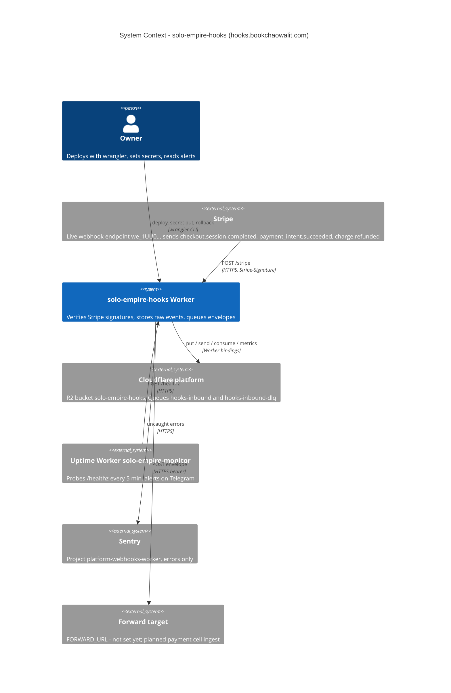

# 05 — C4 Context

Sources: `wrangler.toml`, `src/worker.ts`, `src/sentry.ts`, `README.md` ("State", "Stripe (2026-10-24…)", "Queue (2026-11-03…)"), `bookchaowalit/platform-uptime-worker:src/targets.ts`, `bookchaowalit/platform-uptime-worker:wrangler.toml`
