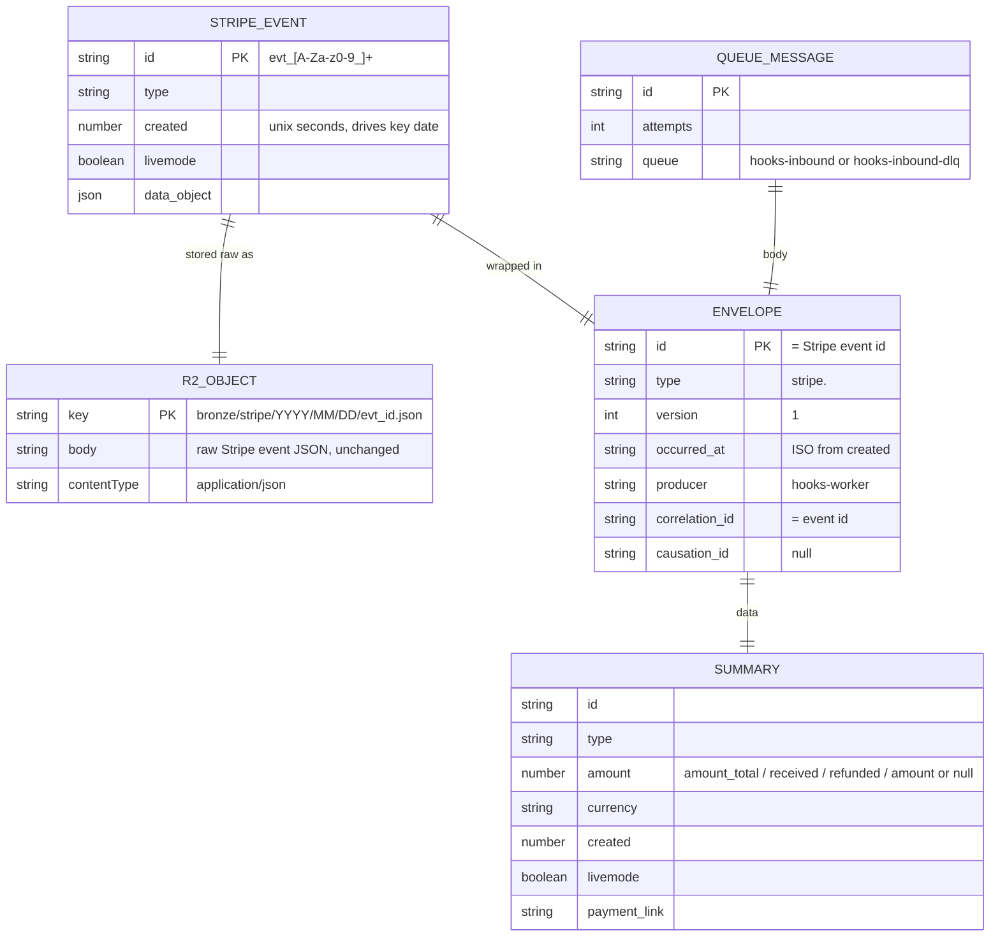

# 09 — Data model (bindings, not a database)

ไม่มี SQL/KV/D1/Durable Object; persisted data อยู่ใน R2 bucket หนึ่งตัวและ Cloudflare Queue สองตัว (wrangler.toml) ER ด้านล่างเป็น "logical" ของ object และ message ที่ code เขียน

| Binding | Type | Name | ใช้ทำอะไร |
|---|---|---|---|
| `HOOKS_BUCKET` | R2 | `solo-empire-hooks` | raw event (bronze) |
| `HOOKS_QUEUE` | Queue producer + consumer | `hooks-inbound` | envelope; consumer batch 10 / 5 s / 5 retries |
| `HOOKS_DLQ` | Queue producer (อ่าน metrics เท่านั้น) | `hooks-inbound-dlq` | message ที่ forward ล้มเหลว |

Sources: `wrangler.toml`, `src/worker.ts` (`StripeEvent`, `stripeObjectKey`, `summarize`, `envelope`, `MessageLike`), `tests/events.test.ts`

## Open questions
- retention ของ raw object ใน R2 ไม่ได้กำหนด (lifecycle rule มีแค่ default multipart abort — ดู 14-backup-dr.md)
