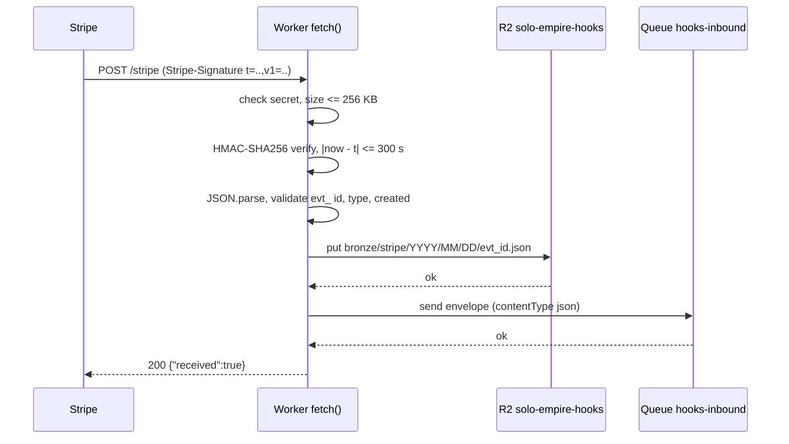
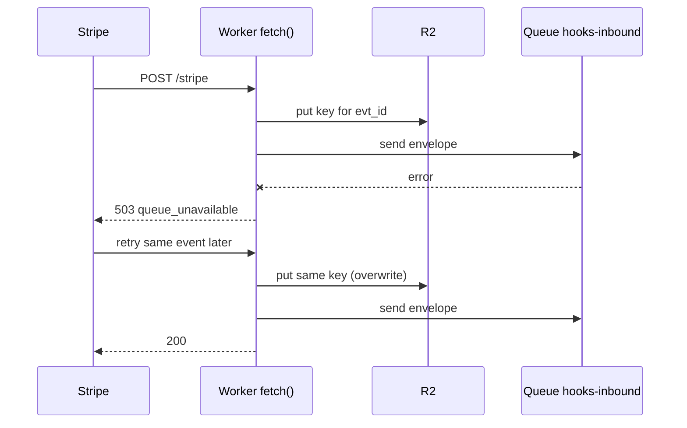
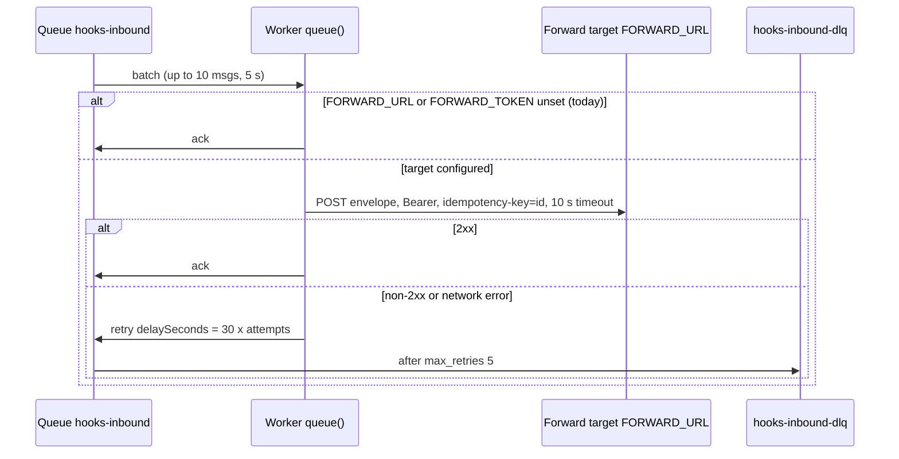
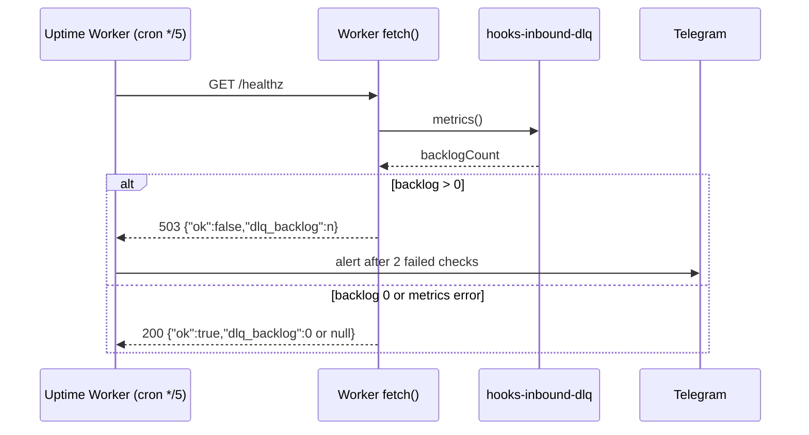

# 10 — Sequences

## S1 — Stripe event สำเร็จ (production path)

## S2 — Queue send ล้มเหลว (Stripe retry, R2 idempotent)

## S3 — Consumer forward พร้อม retry และ DLQ

## S4 — Health probe กับ DLQ backlog

Sources: `src/worker.ts`, `wrangler.toml`, `tests/queue.test.ts`, `tests/worker.test.ts`, `bookchaowalit/platform-uptime-worker:src/monitor.ts` (`FAILURES_BEFORE_DOWN = 2`), `bookchaowalit/platform-uptime-worker:wrangler.toml` (crons)
