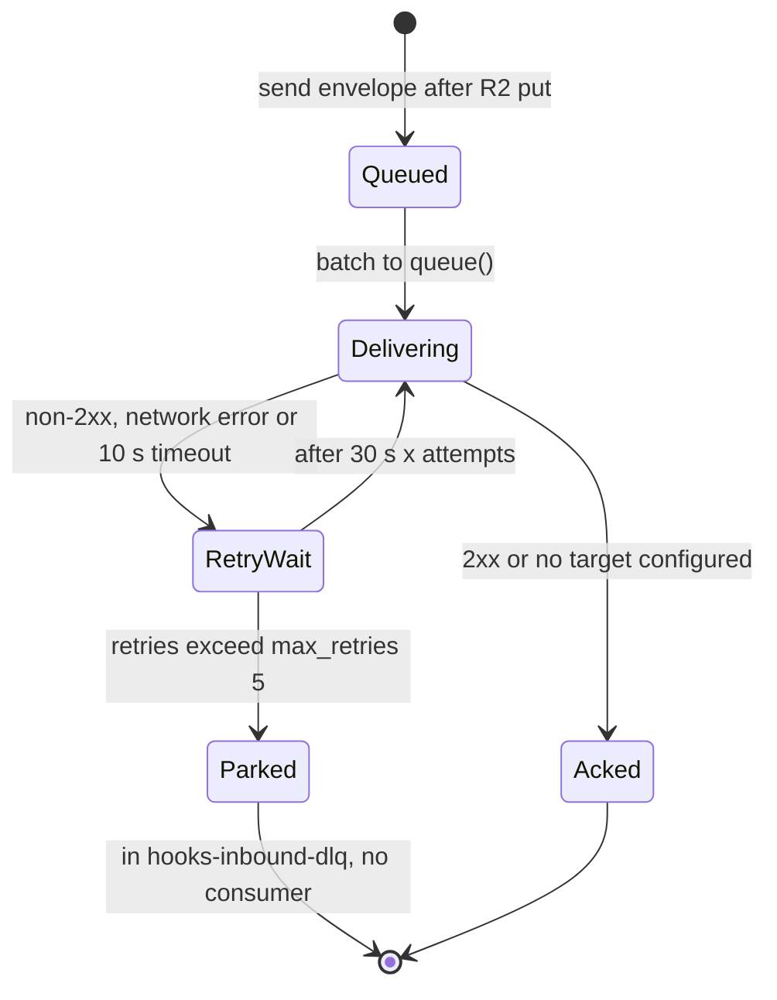
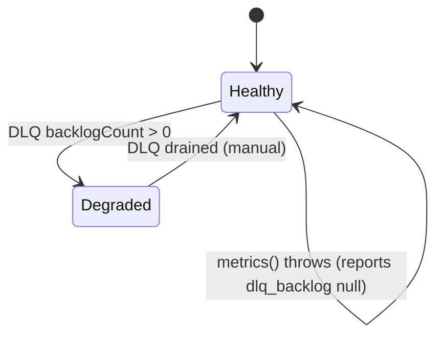
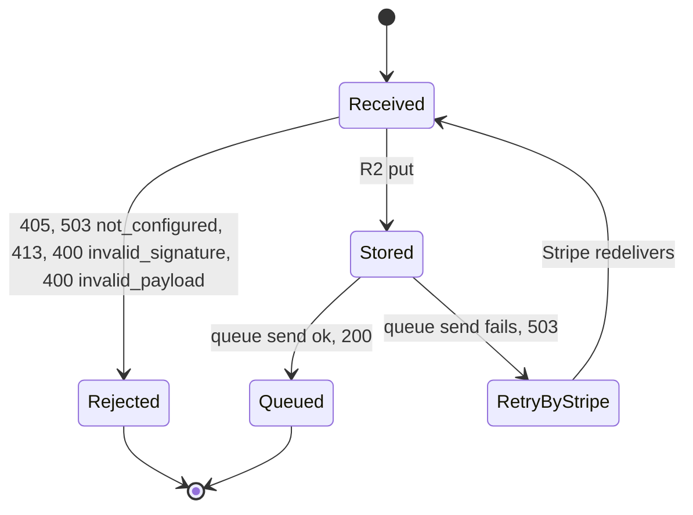

# 11 — State machines

ไม่มี entity ที่มี field `status` ใน storage; lifecycle ที่ code ควบคุมจริงคือ queue message และสถานะ health

## Queue message (hooks-inbound)

## Worker health (/healthz)

## Incoming Stripe request

Sources: `src/worker.ts` (`handleQueue`, `handleHealth`, `handleStripe`), `wrangler.toml` (`[[queues.consumers]]`), `tests/queue.test.ts`

## Open questions
- การ drain DLQ (replay หรือ purge) ไม่มีใน repo — ทำด้วยมือผ่าน dashboard/wrangler?
