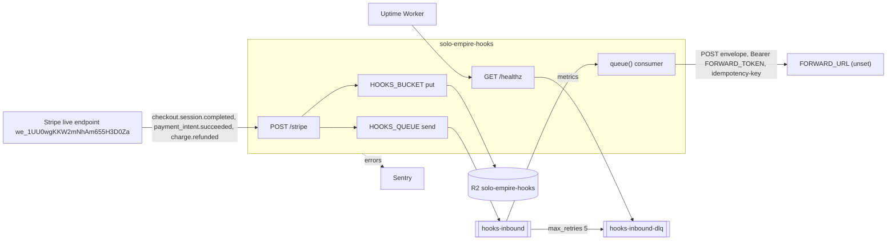

# 12 — API and integrations

## Endpoints (`handleRequest`)

| Method | Path | Auth | Responses |
|---|---|---|---|
| POST | `/stripe` | `Stripe-Signature` HMAC กับ `STRIPE_WEBHOOK_SECRET` | `200 {"received":true}`, `400 invalid_signature`, `400 invalid_payload`, `413 payload_too_large`, `503 not_configured`, `503 queue_unavailable` |
| non-POST | `/stripe` | — | `405 method_not_allowed` |
| GET | `/healthz` | none | `200 {"ok":true,"dlq_backlog":0}`, `503 {"ok":false,"dlq_backlog":n}` |
| any | other | — | `404 not_found` |

ทุก response: `content-type: application/json; charset=utf-8`, `cache-control: no-store` (`json()`)

Hosts: `hooks.bookchaowalit.com` (custom domain) และ `workers.dev` (`workers_dev = true`)

## Integrations

### Outbound forward contract (consumer)
- `POST FORWARD_URL`, headers `authorization: Bearer <FORWARD_TOKEN>`, `content-type: application/json`, `idempotency-key: <envelope.id>`
- body = ADR-0008 envelope; `data` = summary `{id,type,amount,currency,created,livemode,payment_link}`
- 2xx = ack; อื่น ๆ = retry; timeout 10 s

### Legacy path (no `HOOKS_QUEUE`, local tests only)
- `ctx.waitUntil(forward(...))` POST summary (ไม่มี idempotency-key, ไม่มี timeout) — failure แค่ `console.warn`

Sources: `src/worker.ts`, `wrangler.toml`, `README.md` ("Behavior", "Stripe (2026-10-24, live mode)"), `bookchaowalit/platform-ops-cli:infra/platform/domains.yaml`

## Open questions
- จะปิด `workers_dev` หรือไม่ (endpoint ที่สองบน `*.workers.dev` ยังเปิดอยู่ แม้ตรวจ signature เหมือนกัน)
