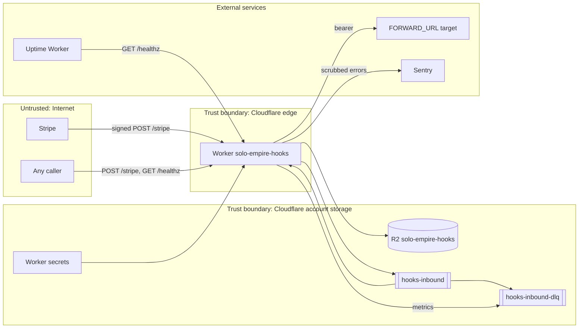

# 13 — Threat model (DFD + STRIDE)

## STRIDE

| Element | Threat | Mitigation in code | Gap |
|---|---|---|---|
| `POST /stripe` | **S**poofing: ส่ง event ปลอม | HMAC-SHA256 + `timingSafeEqual`; ไม่มี secret → 503 (`handleStripe`) | — |
| `POST /stripe` | **T**ampering: แก้ body | signature ครอบ `${t}.${rawBody}`; test "tampered body" | — |
| `POST /stripe` | Replay ของ event เก่า | tolerance 300 s; R2 key ตาม id → overwrite ไม่ซ้ำ | ใน 300 s replay ได้แต่ idempotent (เขียนทับ, queue ส่งซ้ำ) — consumer ต้อง dedupe ด้วย `idempotency-key` |
| `POST /stripe` | **D**oS: body ใหญ่ / request ถี่ | 256 KB limit (`readLimitedBody`) | ไม่มี rate limit / WAF rule ใน repo; `arrayBuffer()` อ่านทั้ง body เมื่อไม่มี `content-length` ก่อนเช็คขนาด |
| `POST /stripe` | Path traversal ใน R2 key | id ต้องตรง `^evt_[A-Za-z0-9_]+$` (`tests/events.test.ts`) | — |
| Responses | **I**nfo disclosure | ไม่ echo body; error code สั้น; `cache-control: no-store` | `/healthz` เปิดเผยจำนวน DLQ backlog ต่อสาธารณะ |
| R2 raw objects | **I**nfo disclosure: PII ใน raw Stripe event | bucket private (binding เท่านั้น) | ไม่มี retention/lifecycle; raw body เก็บ email ฯลฯ ตาม Stripe object |
| Queue envelope | **I**nfo disclosure | `summarize` ส่งเฉพาะ id/type/amount/currency/created/livemode/payment_link (test "drop personal data") | — |
| Forward to target | **S**poofing ของ target / token leak | bearer จาก secret; URL จาก secret เท่านั้น | ไม่มี allowlist ของ host; ยังไม่ได้ตั้ง |
| Forward to target | **D**oS: target ค้าง | `AbortSignal.timeout(10_000)` | — |
| Sentry | **I**nfo disclosure | `scrubEvent`, no breadcrumbs/tracing (`tests/sentry.test.ts`) | — |
| Worker secrets | **E**levation / leak | `wrangler secret put`, ไม่อยู่ใน `wrangler.toml`; CI ไม่มี Cloudflare credential | — |
| Deploy | **R**epudiation / **T**ampering | Cloudflare deployments history | deploy จากเครื่อง local ไม่ผูก Git SHA; `main` ไม่มี branch protection (GitHub API 404 "Branch not protected", 2026-11-03) |
| Supply chain | **T**ampering | Renovate, `security.yml` (gitleaks, semgrep, osv-scanner, trivy), SHA-pinned reusable workflow, `overrides` undici 7.30.1 | `@sentry/cloudflare` ใช้ `^11.8.0` (range) แต่ lockfile ล็อก |

Sources: `src/worker.ts`, `src/sentry.ts`, `wrangler.toml`, `package.json`, `renovate.json`, `.github/workflows/ci.yml`, `tests/events.test.ts`, `tests/sentry.test.ts`, `tests/worker.test.ts`

## Open questions
- ต้องการ Cloudflare rate limiting / WAF สำหรับ `/stripe` หรือไม่ (เช่น allowlist IP ของ Stripe)?
- ควรซ่อน `dlq_backlog` จาก `/healthz` สาธารณะหรือไม่?
- นโยบาย retention ของ PII ใน bronze raw events?
