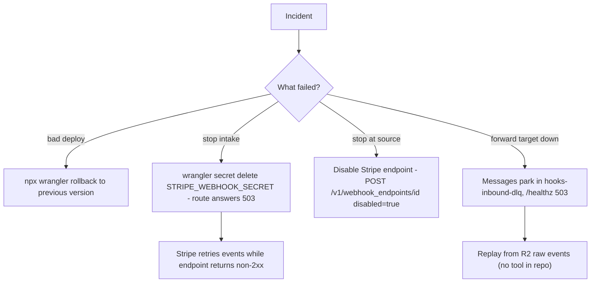

# 14 — Backup and DR

| Data | Where | Backup reality | Restore |
|---|---|---|---|
| Raw Stripe events | R2 `solo-empire-hooks` `bronze/stripe/...` | ไม่พบ backup job หรือ replication ใน repo หรือใน ops record ที่ระบุ bucket นี้; lifecycle มีแค่ "Default Multipart Abort Rule" (`wrangler r2 bucket lifecycle list`, 2026-11-03) | Stripe Dashboard / API เก็บ event ซ้ำได้ (ฝั่ง Stripe) — ไม่ได้ระบุ procedure ใน repo |
| Queue messages | `hooks-inbound`, `hooks-inbound-dlq` | ไม่มี; ADR-0008: free plan retention 24 h | rebuild จาก R2 raw (ADR-0008 "R2 stays the source of truth and the replay source") |
| Worker code | GitHub `bookchaowalit/platform-webhooks-worker` | Git | `npx wrangler deploy` หรือ `npx wrangler rollback` (README "Rollback") |
| Secrets | Worker secrets; copy ใน Infisical `/stripe` (STRIPE_WEBHOOK_SECRET) | Infisical | `wrangler secret put` |

- RTO: not defined
- RPO: not defined (ทุก event ที่ได้ `200` อยู่ใน R2 แล้ว; event ที่ได้ non-2xx ถูก Stripe retry)

Sources: `README.md` ("Rollback", "State"), `wrangler.toml`, `src/worker.ts`, [ADR-0008](https://github.com/bookchaowalit/architecture-docs/blob/main/docs/architecture/decisions/ADR-0008-messaging-queue-and-event-broker.md); ops record: prod-baseline-monitoring-backups (2026-11-03) — nightly backup ครอบคลุม DB เท่านั้น ไม่ได้ระบุ bucket นี้

## Open questions
- R2 bucket นี้ต้อง backup/replicate หรือไม่ หรือถือ Stripe เป็น backup?
- RTO/RPO สำหรับ hooks ingress
- เครื่องมือ replay R2 → queue ยังไม่มี
