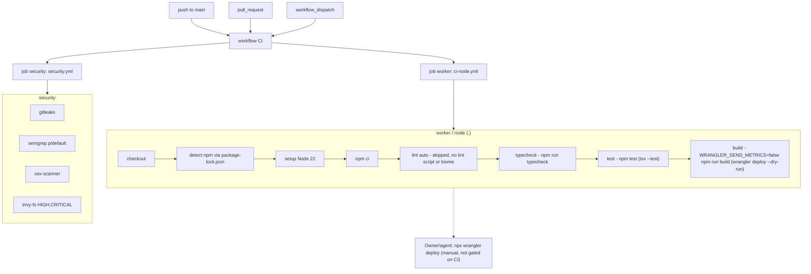

# 15 — CI/CD pipeline

workflow เดียว `.github/workflows/ci.yml` (name `CI`) เรียก reusable workflow 2 ตัวจาก `bookchaowalit/platform-ci-workflows` pin SHA `87dc5e1c7e0416886a6371d5a101bb2ccba38edd` (v1.1.1) บน GitHub-hosted runner `ubuntu-24.04` (default ของ reusable workflow; repo เป็น public) CI ไม่ deploy

- `concurrency: ci-${{ github.ref }}`, `cancel-in-progress: true`; `permissions: contents: read`
- Renovate: weekly "before 9am on monday" (Asia/Bangkok), lockfile maintenance รายเดือน, group `platform-ci-workflows`

Sources: `.github/workflows/ci.yml`, `package.json`, `renovate.json`, `bookchaowalit/platform-ci-workflows:.github/workflows/ci-node.yml@87dc5e1c`, `bookchaowalit/platform-ci-workflows:.github/workflows/security.yml@87dc5e1c`; job names จาก `gh run view 41669997267` (2026-11-03)

## Recent results (`gh run list -R bookchaowalit/platform-webhooks-worker -L 50`)
10 runs ทั้งหมด: 7 success, 3 failure — ทั้ง 3 failure มาจาก `security / osv-scanner` และ `security / trivy-fs` (2026-10-24 09:10Z, 2026-11-03 15:53Z, 16:02Z) แก้ด้วย `101a732` (pin undici 7.30.1); job `worker / node` ผ่านทุกครั้ง
