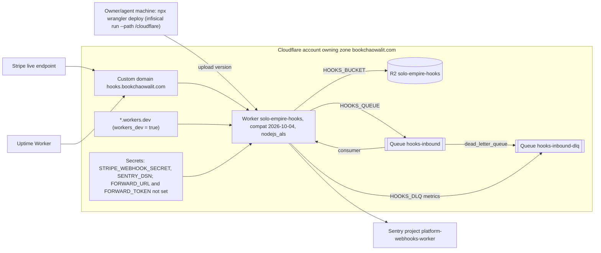

# 16 — Deployment

| Item | Value | Source |
|---|---|---|
| Worker name | `solo-empire-hooks` | `wrangler.toml` |
| Route | `hooks.bookchaowalit.com` custom domain | `wrangler.toml`, `README.md` |
| Env | production เดียว ไม่มี `[env.*]` / staging | `wrangler.toml` |
| Current version | `03d4e656` (2026-11-03 16:20Z) | `wrangler deployments list` (2026-11-03) |
| Registry | `domains.yaml` status `live`, `access: public-signed` | `bookchaowalit/platform-ops-cli:infra/platform/domains.yaml` |

Sources: `wrangler.toml`, `README.md`, `package.json`; ops record: messaging-layer-adr-0008 (2026-11-03) ("no FORWARD_URL yet")

## Open questions
- `README.md` "Owner deploy steps" ยังใช้ `cd infra/hooks-worker` และบอกให้ uncomment routes (ล้าสมัยหลังย้ายออกจาก hub และ bind domain แล้ว)
- ไม่มี staging environment — ตั้งใจหรือไม่?
