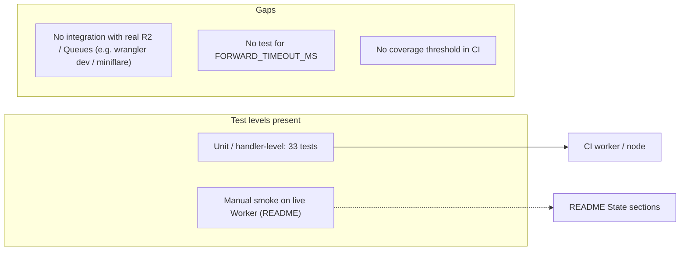

# 17 — Test coverage matrix

Test runner: `tsx --test tests/*.test.ts` (node:test) — 33 tests ใน 5 files; ทั้งหมดเป็น unit/handler-level (เรียก `handleRequest` / `handleQueue` ตรงด้วย fake R2/Queue/fetch) ไม่มี integration กับ Cloudflare จริงหรือ e2e; ไม่มี coverage gate (`coverage-threshold` ไม่ได้ตั้งใน `ci.yml`)

| Feature | Unit | Handler-level (fakes) | Integration (real bindings) | E2E | Files |
|---|---|---|---|---|---|
| Signature parse / verify / rotation / tolerance | yes | yes | — | manual smoke (README) | `signature.test.ts`, `worker.test.ts` |
| Body limit 413 | — | yes | — | — | `worker.test.ts` |
| Payload validation (`evt_`, type, created) | — | yes | — | — | `events.test.ts` |
| R2 key format + idempotent write | yes | yes | — | manual smoke 2026-10-24 | `worker.test.ts` |
| Summary drops PII | yes | — | — | — | `events.test.ts` |
| Queue envelope send / 503 on failure | — | yes | — | manual smoke 2026-11-03 (`wrangler tail`) | `queue.test.ts` |
| Consumer forward / retry / no-target ack | — | yes | — | — | `queue.test.ts` |
| Forward 10 s timeout | — | **gap** | — | — | — |
| DLQ after 5 retries | — | **gap** (Cloudflare config, not testable in node) | — | — | — |
| `/healthz` ok / 503 backlog | — | yes | — | uptime Worker probe | `worker.test.ts`, `queue.test.ts` |
| 404 / 405 routing | — | yes | — | — | `worker.test.ts` |
| Legacy waitUntil forward | — | yes | — | — | `worker.test.ts` |
| Sentry options + scrub | yes | — | — | — | `sentry.test.ts` |
| Missing secret 503 | — | yes | — | — | `worker.test.ts` |

Sources: `tests/signature.test.ts`, `tests/events.test.ts`, `tests/worker.test.ts`, `tests/queue.test.ts`, `tests/sentry.test.ts`, `package.json`, `.github/workflows/ci.yml`, `README.md`
