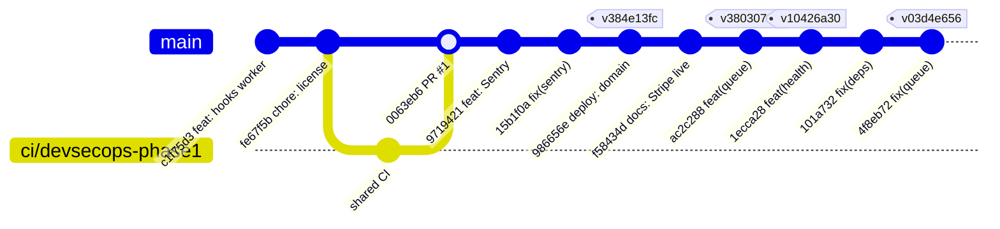
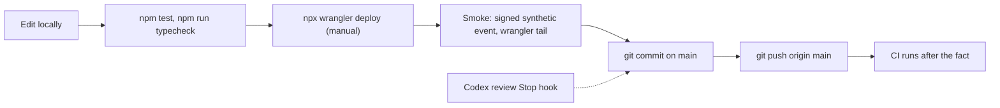

# 18 — Git and release workflow

จาก `git log`: 14 commits บน `main`, มีเพียง PR #1 (`0063eb6`, branch `ci/devsecops-phase1`) ผ่าน pull request ที่เหลือ commit/push ตรงเข้า `main`; `main` ไม่มี branch protection หรือ ruleset (GitHub API, 2026-11-03) Deploy แยกจาก Git: รัน `wrangler deploy` จาก working tree ด้วยมือ (deploy เกิดก่อน commit ที่ตรงกันราว 13–138 วินาที)

tags ในกราฟ (`v…`) คือ Worker version id ที่ deploy ใกล้ commit นั้น ไม่ใช่ Git tag จริง — repo ไม่มี Git tag หรือ GitHub release

Sources: `git log --format='%h %ad %s' --date=iso-strict`, `gh run list -R bookchaowalit/platform-webhooks-worker -L 50`, `wrangler deployments list --name solo-empire-hooks` (2026-11-03), `.github/workflows/ci.yml`, `README.md`; commit `4f8eb72` message "(Codex review)"
