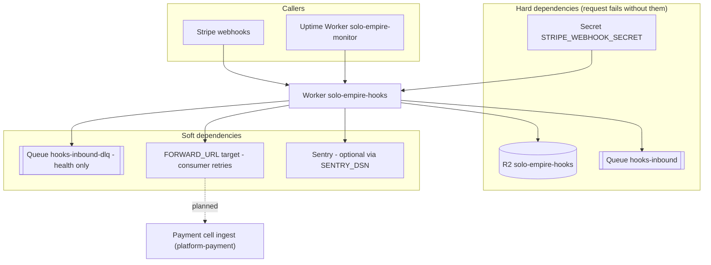

# 19 — Service dependency map (runtime)

| Dependency | ถ้าล่ม |
|---|---|
| R2 put throws | uncaught error → Worker error response 5xx (ไม่มี try/catch รอบ `HOOKS_BUCKET.put`) → Stripe retry; Sentry รับ error |
| Queue send throws | `503 queue_unavailable` → Stripe retry |
| Secret ไม่มี | `503 not_configured` |
| DLQ `metrics()` throws | `/healthz` ยังตอบ 200 (`dlq_backlog: null`) |
| Forward target ล่ม | retry 5 ครั้ง → DLQ → `/healthz` 503 |
| Sentry ล่ม | ไม่มีผลต่อ response (SDK) |

Sources: `src/worker.ts`, `wrangler.toml`, `README.md` ("Queue": "the payment cell's ingest endpoint becomes the target when it is ready"), `bookchaowalit/platform-uptime-worker:src/targets.ts`

## Open questions
- "payment cell" ใน README คือ `platform-payment` ใช่หรือไม่ (README ไม่ได้ระบุชื่อ repo)
