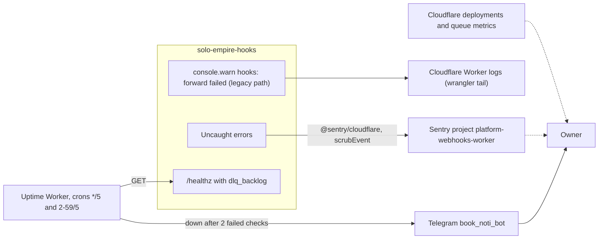

# 20 — Observability

| Signal | Instrumentation | Watched by |
|---|---|---|
| Errors | `Sentry.withSentry` + `sentryOptions` (errors only, ไม่มี tracing) | Sentry project `platform-webhooks-worker` (README "State") |
| Availability + DLQ backlog | `/healthz` (503 เมื่อ backlog > 0) | uptime Worker target `hooks-worker` → Telegram |
| Logs | `console.warn` เฉพาะ legacy forward; ไม่มี structured log อื่น | `wrangler tail` (ใช้ใน smoke README) |
| Signature rejections | response `400 invalid_signature` | PRODUCT.md อ้าง "Worker logs" แต่ code ไม่ได้ log rejection |
| Event completeness | R2 objects vs Stripe Dashboard | manual (PRODUCT.md) |

Sources: `src/worker.ts`, `src/sentry.ts`, `README.md`, `PRODUCT.md`, `bookchaowalit/platform-uptime-worker:src/targets.ts`, `bookchaowalit/platform-uptime-worker:src/monitor.ts`, `bookchaowalit/platform-uptime-worker:wrangler.toml`; ops record: prod-baseline-monitoring-backups (2026-11-03) (alerts via `book_noti_bot`)

## Open questions
- Sentry alert rule ส่งไปที่ไหน (ไม่มีหลักฐานใน repo)
- Workers Logs / Logpush เปิดอยู่หรือไม่ (`wrangler.toml` ไม่มี `[observability]`)
- error ที่ถูก catch (queue send fail, forward fail ใน consumer) ไม่ถูกรายงาน Sentry — ต้องการ metric หรือไม่?
