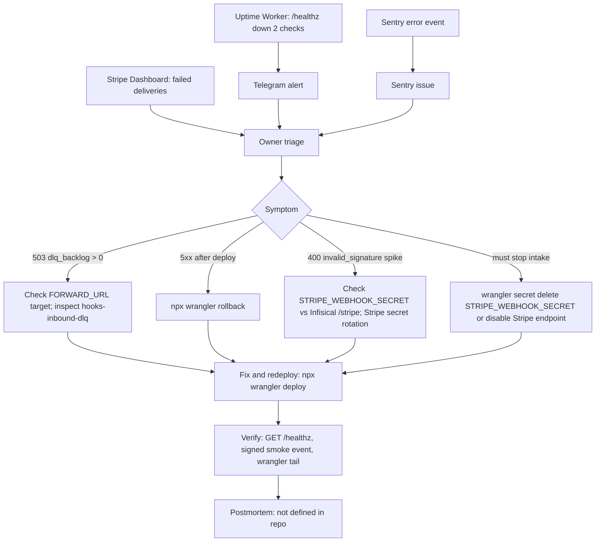

# 21 — Incident response

ไม่มี runbook แยกใน repo; flow ด้านล่างประกอบจาก alert channel ที่มีจริง (uptime → Telegram, Sentry) และ rollback/kill-switch ใน README

Sources: `README.md` ("Rollback", "State", smoke steps), `src/worker.ts` (`handleHealth` comment "the uptime Worker alerts on Telegram"), `bookchaowalit/platform-uptime-worker:src/monitor.ts`

## Open questions
- ที่เก็บ postmortem / incident log ของ platform service นี้?
- severity และ on-call (solo owner) — ยังไม่กำหนดใน repo
