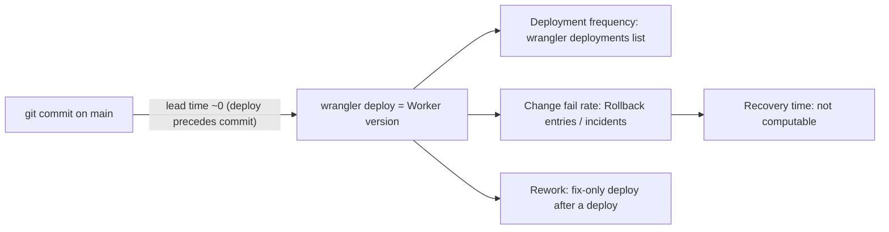

# 22 — DORA metrics

Window: 90 วัน 2026-08-05 → 2026-11-03 "Deployment" = Worker version ที่ upload ด้วย `wrangler deploy` (CI ไม่ deploy) — Cloudflare เก็บเฉพาะประวัติหลังย้ายมา account ที่เป็นเจ้าของ zone (2026-10-23, commit `986656e`); deploy ก่อนหน้าบน account เดิม `4a3ba0ee…` อ่านไม่ได้ (PRODUCT.md)

## Data

```bash
# deployments (read-only; Cloudflare token from Infisical /cloudflare)
infisical run --projectId "$INFISICAL_PROJECT_ID" --env dev --path /cloudflare --silent -- \
  npx wrangler@4.131.1 deployments list --name solo-empire-hooks
# commits that change the bundle or its tests
git log --since=2026-08-05 --format='%h %cI %s' -- src tests wrangler.toml package.json package-lock.json
# CI runs
gh run list -R bookchaowalit/platform-webhooks-worker -L 50 --json createdAt,event,conclusion,headBranch
```

| Created (UTC) | Version | Source | Matched commit |
|---|---|---|---|
| 2026-10-23 15:59:59 | `384e13fc` | Upload | `986656e` (+ `b4e1325`, `5ee1be2`, `9719421`, `f1694ea`, `15b1f0a`) |
| 2026-10-23 16:00:19 | `ab0c1104` | Secret Change | — |
| 2026-10-24 09:09:16 | `60231046` | Secret Change | — (README: STRIPE_WEBHOOK_SECRET set 2026-10-24) |
| 2026-11-03 15:51:00 | `380307d1` | Unknown (deployment) | `ac2c288` |
| 2026-11-03 16:01:50 | `10426a30` | Unknown (deployment) | `1ecca28` |
| 2026-11-03 16:20:17 | `03d4e656` | Unknown (deployment) | `101a732`, `4f8eb72` |

การจับคู่ version ↔ commit อนุมานจากเวลา (version ไม่มี message/tag); deploy เกิดก่อน commit ที่ตรงกัน 13–138 s จึงนับ lead time เป็น 0

## Metrics

| Metric | How measured here | Value (90 d) |
|---|---|---|
| Deployment frequency | code deployments (Source ≠ Secret Change) | **4** ใน 90 วัน (บน 2 วันที่ต่างกัน: 2026-10-23, 2026-11-03) ≈ 0.31/สัปดาห์; + 2 secret-change versions |
| Lead time for changes | commit time → first deployment that contains it, ต่อ commit ที่แตะ `src/ tests/ wrangler.toml package*.json` ตั้งแต่ 2026-10-21 (ก่อนหน้านั้น deploy history ไม่มี) | **median 4.96 h** (n = 10: 0, 0, 0, 0, 0.27 h, 9.64 h, 9.64 h, 45.57 h × 3) |
| Change fail rate | deployment ที่ตามด้วย rollback (Source "Rollback") หรือ incident record | **0 / 4 = 0 %** — ไม่มี rollback ใน deployments list; ไม่พบ incident record (ข้อจำกัด: ไม่มี incident log) |
| Failed deployment recovery time | เวลาจาก failed deploy → recovery | **not computable** — ไม่มี failed deployment ที่บันทึกไว้ |
| Deployment rework rate | deployment ที่มีแต่ `fix:` แก้ deployment ก่อนหน้า (unplanned) | **1 / 4 = 25 %** — `03d4e656` (fix(queue) timeout จาก Codex review + fix(deps)) แก้ `380307d1` ภายใน 29 นาที |

ข้อมูลเสริม: CI 10 runs, 3 failure (security scans เท่านั้น, ดู 15-cicd-pipeline.md) — ไม่ใช่ deployment failure เพราะ CI ไม่ใช่ deploy gate



Sources: `wrangler deployments list --name solo-empire-hooks` (รัน 2026-11-03), `git log`, `gh run list -R bookchaowalit/platform-webhooks-worker -L 50`, `.github/workflows/ci.yml`, `PRODUCT.md`, `README.md`

## Open questions
- ใส่ `--message "<git sha>"` ตอน `wrangler deploy` เพื่อให้ version ผูก commit ได้ตรง?
- จะบันทึก incident ที่ไหนเพื่อให้ change fail rate / recovery time วัดได้?
